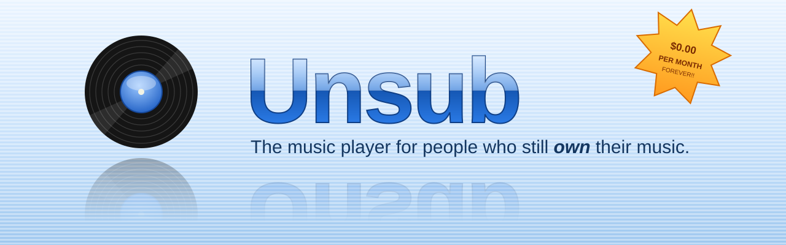
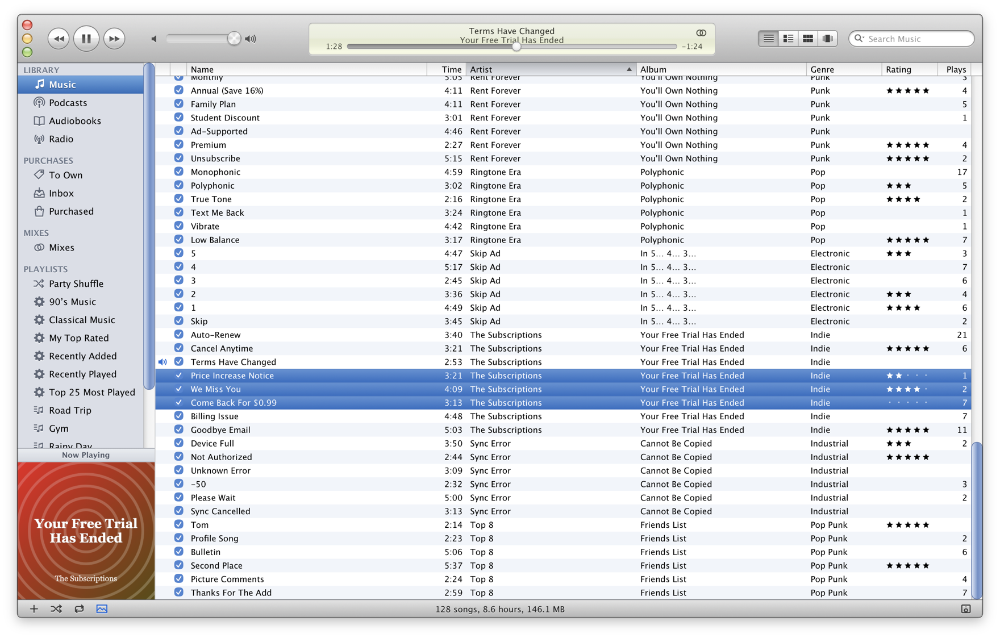
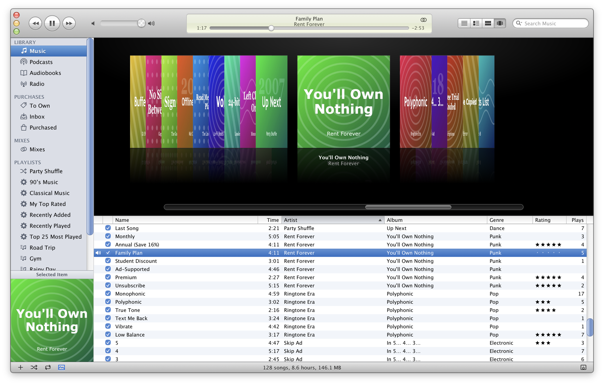
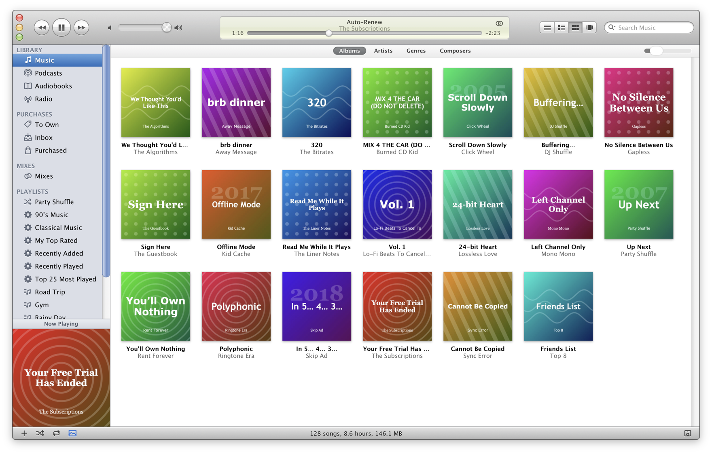
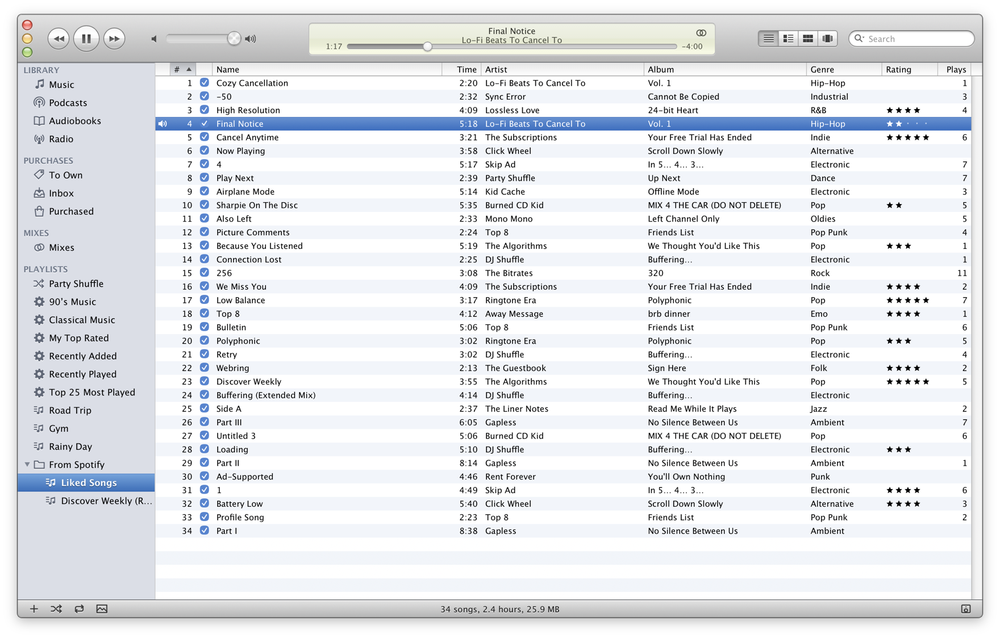
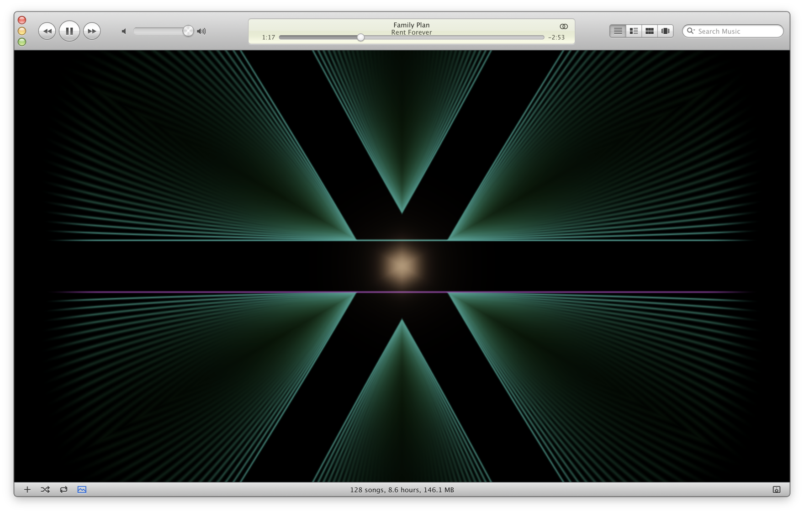

<p align="center">
  
</p>

<p align="center">
  
  
  
  
  
  
  
  
</p>

<h3 align="center">Cancel your subscription. Keep your music.</h3>

<p align="center">
  <a href="https://halfwoods.com/unsub/"><b>⬇ Download for Mac or Windows</b></a>
  &nbsp;·&nbsp; <a href="#leaving-spotify">Leaving Spotify?</a>
  &nbsp;·&nbsp; <a href="#faq">FAQ</a>
</p>

---

Your music used to live on your computer, in a folder, as files. You could burn it, back it up, and sync it to a small white device with a click wheel. Nobody could take it back.

Then someone decided you should pay every month, forever, to rent the music you used to own. Songs disappear when two companies disagree about a contract. The recommendations treat the one night you played lo-fi beats as your personality.

**Unsub** is a desktop music player for files you own. It's modeled on classic iTunes, from before it became a storefront with a play button. It plays your files, organizes your library, rips your CDs, syncs your iPod and gets out of the way. No account, no feed, no “Made For You”.

<p align="center">
  
</p>

<table>
  <tr>
    <td width="50%"><br><sub><b>Album Artwork.</b> Browse by cover.</sub></td>
    <td width="50%"><br><sub><b>Album grid.</b> Every album in your library.</sub></td>
  </tr>
  <tr>
    <td width="50%"><br><sub><b>From Spotify.</b> Liked Songs, rebuilt from songs you own.</sub></td>
    <td width="50%"><br><sub><b>Visualizer.</b> The Classic style.</sub></td>
  </tr>
</table>

<sub>The artists and albums in these screenshots are fictional.</sub>

## What it does

- **Plays music you own.** MP3, AAC, ALAC, FLAC, Opus, Vorbis, WAV, AIFF, WavPack and APE. Gapless and bit-perfect.
- **Brings your stuff with you.** Import your Music or iTunes library with its play counts, ratings and playlists intact. Leaving Spotify or YouTube Music? Bring your playlists **and your listening history**. Songs you don't own yet go on a list called **To Own**.
- **Plays to your speakers.** Chromecast, Sonos and other UPnP speakers, plus AirPlay on the Mac, through its sound output. No premium tier.
- **Works with an iCloud Drive library.** A 37,000-song library that isn't actually on your Mac is fine. Unsub reads it without downloading anything and fetches each song when you press play.
- **Syncs classic iPods.** Classic, video, mini, nano 1st–4th gen, shuffle. *(New, and so far tested only against simulated iPods. Tell us how yours does.)*
- **Syncs other players too.** Rockbox, USB players, and Android phones that mount as a USB drive.
- **Rescues the music trapped on your old iPod.** iTunes never let you. Unsub copies it back into your library with its play counts, ratings and playlists, and the iPod isn't touched. (Songs bought from the iTunes Store before 2009 are still copy-protected, so those stay behind.)
- **Smart playlists, Party Shuffle and "more like this" mixes.** Recommendations are worked out on your computer, not for an ad network.
- **Rips CDs** on the Mac, with MusicBrainz lookup and AccurateRip verification.
- **Cleans up song info.** `01 - track01 (Official Video) [HQ] www.website.com` becomes a song title again. You see a preview first.
- **Podcasts** over RSS.
- **Internet radio** from the Radio Browser directory, playlist files and live streams.
- **A visualizer** that actually reacts to the music.
- **Streams to your phone.** A Subsonic-compatible server is built in, so phone apps can play your library from your own computer. No middleman.

## Download

These links always download the newest version. The [download page](https://halfwoods.com/unsub/) picks the right one for you; older versions and release notes are on [Releases](https://github.com/halfwoods/Unsub/releases).

- **Mac** (Apple Silicon: macOS 11+; Intel: macOS 11+ with experimental support for fully updated High Sierra 10.13.6 and later): **[Apple chip](https://github.com/halfwoods/Unsub/releases/latest/download/Unsub_arm64.dmg)** or **[Intel](https://github.com/halfwoods/Unsub/releases/latest/download/Unsub_x86_64.dmg)**. Open the `.dmg` and drag Unsub to Applications. It's signed and notarized, so it opens like any other app.
- **Windows** (10 or 11, 64-bit): **[installer](https://github.com/halfwoods/Unsub/releases/latest/download/Unsub_x64-setup.exe)**, or the [MSI](https://github.com/halfwoods/Unsub/releases/latest/download/Unsub_x64_en-US.msi) if you prefer. The Windows build isn't code-signed yet (certificates cost money), so you'll see “Windows protected your PC”. Choose **More info › Run anyway**.

Unsub updates itself from new releases, and only when you let it.

## How to

Click an entry to open it. Menu paths use `›`. `Cmd` on a Mac is `Ctrl` on Windows.

<details>
<summary><b>Add your music</b></summary>

1. Click **Add Music Folder…** in the sidebar or empty Music library, then choose the folder your music lives in. You can add more folders later.
2. Or use **File › Add Music Folder…** (`Cmd+O`), **File › Add Music Files…** (`Shift+Cmd+O`), or drag folders and files onto the window. A drop target appears while you drag. `.pls` and `.m3u` files go to Radio instead.
3. Progress shows in the display at the top. When it's done you'll get a notice if nothing was found or some files couldn't be added.

On a first launch with an empty library, **Choose Folder…** in the welcome sheet lets you pick any folder. Suggested Music folders show their full paths and are added only when you click their Add button. You can also drop music onto the welcome sheet. Reopen it any time from **Help › Welcome to Unsub…**.

Unsub does not scan a music source automatically at startup. It creates a default media destination and reopens your saved library, including a library from an older Unsub installation.

**iCloud Drive.** Unsub spots songs that aren't on this computer without opening them, so scanning downloads nothing. Until it knows better, it names those songs from their file and folder names. **Advanced › Get Song Details from iCloud…** (Mac and Windows) later downloads each one in turn to read its tags and cover, then gives it back. Press play on an iCloud-only song and it downloads first.

**What happens to your files.** Nothing, by default. Unsub indexes them where they are. Two options in **Unsub › Preferences… › Advanced** change that, both off:

- **Copy files to media folder when adding to library** copies, never moves. Your originals stay put.
- **Keep media folder organized** tidies files already inside the media folder into `Album Artist/Album/`. Files kept anywhere else aren't touched.

The media folder is `Unsub` inside your Music folder (`~/Music/Unsub` on a Mac), and **Change…** moves it. CD rips, podcasts and store downloads also land there.

Limits: it reads `mp3 m4a m4b mp4 aac flac ogg oga opus wav aif aiff wv ape`. Hidden files are skipped. Symlinks are followed. iCloud-only songs are never copied.
</details>

<details>
<summary><b>Bring your Music or iTunes library</b></summary>

**On a Mac**

1. Choose **File › Import Music Library**. macOS asks to let Unsub see “Media & Apple Music” the first time.
2. The sheet shows how many songs are in your library and whether their files are where Music expects them. If some aren't, click **Choose Folder…** and point at where your music files are now. The button reads **Import Without Locating** until you do.
3. Click **Import**.

**On Windows**

1. In Music or iTunes, choose **File › Library › Export Library…** and save the XML.
2. In Unsub, choose **File › Import Library XML…** and pick that file. The same sheet follows.

The Mac has **Import Library XML…** too, if you'd rather use an export.

What comes over: songs, podcasts and audiobooks that have files (added where they are, not copied), their tags, play counts, skip counts, last played dates, ratings (rounded to whole stars), date added, and your playlists and playlist folders. Importing again updates the same playlists.

Limits: smart playlists arrive as the songs they hold today, since Music's rules don't carry over. Apple Music streaming-only songs, videos and other media don't come. To list them, open **Purchases › To Own** and click **Compare with Music Library** (Mac) or **Choose Library XML…**. Songs that exist only in iCloud arrive as placeholders and download when you play them. A dialog titled **Import Complete** lists what was added and what wasn't.
</details>

<details>
<summary><b>Choose columns and browse your library</b></summary>

**Music › Songs, Albums and Artists** opens the song list or the existing artwork grid. The toolbar still offers List, Album List, Grid and Album Artwork. Open an artist to browse their albums from oldest to newest, then open an album to see its songs. Breadcrumbs and Back return to the previous view. Artist covers come from your local albums; artists without artwork show initials. Search and playlist scope stay in effect, including when you use Play or Shuffle.

Choose **View › Go to Current Song** (`⌘L` on Mac, `Ctrl+L` on Windows/Linux) to select and scroll to the playing or paused song. It keeps the current playlist when possible, clears filters that hide the song, and otherwise opens its library or device list. Playback continues unchanged.

Right-click a song heading to show or hide metadata, or choose **View › Show View Options…** (`⌘J` on Mac, `Ctrl+J` on Windows). Search the checklist for Year, Album Artist, Composer, track/disc numbers, dates, playback counts and audio properties. Drag headings to reorder, drag a divider to resize, or double-click a divider to fit its contents. View Options also provides keyboard-accessible layout controls.

Layouts and sorting are saved on this computer. Playlists inherit the library layout until customized; **Restore Defaults** removes a playlist override. Choose Listening, Library Cleanup or Audio Quality, save a named layout, or explicitly apply the current layout to selected other playlists. A regular playlist's **#** heading restores its stored order for drag reordering.

**Show Column Browser** adds the classic Genre | Artist | Album filters above the song list. Each choice narrows the next list and combines with search and the current playlist. Use **All**, **Clear Filters**, or hide the browser to reset. These filters are separate from choosing which metadata columns are visible. CDs, devices and shared libraries keep their source-specific controls.

</details>

<a id="leaving-spotify"></a>

<details open>
<summary><b>Leave Spotify, YouTube Music or Last.fm</b></summary>

1. **Add your music first** (see above). Unsub matches your playlists and history against songs you already have.
2. **Ask for your data.** Choose **File › Import from Spotify, YouTube Music or ListenBrainz…** (the welcome sheet's **Bring your Spotify playlists** row opens the same sheet). Pick a tab. Its buttons open the right page.
   - **Spotify.** On Spotify's privacy page, ask for **“Account data”** (your playlists and the last year of plays; takes a few days) and **“Extended streaming history”** (every play; up to 30 days). An Exportify CSV folder works too.
   - **YouTube Music.** In Google Takeout, choose **“YouTube and YouTube Music”**, keep playlists, music and history, and set history to JSON. History counts only songs from artists' “Topic” channels. Google's English export reads best.
   - **Last.fm.** Last.fm has no file export. Import your history into [ListenBrainz](https://listenbrainz.org) first (**Import Last.fm History** in its settings), then export from ListenBrainz and use the ListenBrainz tab.
3. **Choose the export.** Click **Choose File…** (zip, json, jsonl or csv) or **Choose Folder…**. The sheet shows how many playlists, songs and plays it matched.
4. **Click Import.** **Add plays to play counts** is on by default and appears only if the export has plays.
5. **Cancel.** Your playlists and history are already in Unsub.

Your playlists appear in a folder named *From Spotify* (or *From YouTube Music*, *From ListenBrainz*), in their original order. Importing the same export again refills them in place. The export is read on your computer. Nothing is uploaded, and there's no account or API key.

**What To Own is.** An import brings names, not audio. Unsub can only rebuild a playlist from songs you own, so those are the only songs that go in. The rest are listed on **Purchases › To Own** in the sidebar:

- playlist songs it couldn't match
- songs you played at least twice (only if **Add plays to play counts** is on)

Each album has buy buttons for Bandcamp, Qobuz, 7digital and iTunes, and **Find Stores** looks up exact pages. Once the song is in your library, it shows as **In Library** and drops out of **To Buy**. To clear entries yourself, click the **×** on a row, right-click **Remove from To Own**, or use the **Forget Spotify Songs** button (library and playlists stay as they are; importing again brings the songs back). **Compare with Music…** in the To Own header adds your Apple Music streaming-only songs (on Windows it asks for a Library XML).

Limits: plays under 30 seconds aren't counted. A song that fits more than one of yours equally well is left out. Importing a second export never removes anything from To Own. Plays you scrobbled from the Music app may count twice if you also imported your Music library.
</details>

<details>
<summary><b>Store downloads</b></summary>

Unsub can watch your Downloads folder for purchases from Bandcamp, Qobuz, 7digital and HDtracks. It's off until you turn it on.

1. Open **Purchases › Inbox** in the sidebar and click **Watch Downloads Folder**. macOS asks first.
2. Download your purchase as usual. When it finishes, a row appears with the store, album, artist and size.
3. Click **Add to Library**, or **Ignore**.
4. **Purchases › Purchased** lists everything added this way.

**Add to Library** unpacks the download into `Unsub/Purchases/Album Artist/Album/` in your media folder, then adds it like any folder. The original zip is left alone. An album folder that already exists is never touched. The new one becomes “Album (2)”.

Turn it off with **Stop Watching** in the bottom bar. **Check Now** looks straight away.

Limits: it offers `.zip` archives that contain audio, and folders of audio. Folders already in Downloads when you first start watching are skipped; zips already there are offered. Downloads still in progress are ignored. Duplicates are skipped. Audio types: `flac mp3 m4a ogg opus wav aif aiff wv`. Anything it can't identify is labelled “Download”.
</details>

<details>
<summary><b>Rip a CD</b></summary>

Mac only. On Windows and Linux, Unsub can't read audio CDs.

1. Insert the CD. It appears under **Devices** in the sidebar. Select it.
2. Unsub looks the disc up on MusicBrainz. If several releases share the disc, an **Edition** menu appears.
3. Untick any tracks you don't want. All are ticked.
4. Click **Import Settings…** to choose a format: **FLAC Encoder** (the default), **Apple Lossless Encoder** or **AAC Encoder** (128, 256 or 320 kbps). **Verify songs with AccurateRip** is on by default.
5. Click **Import CD**. Each track joins the library as it finishes. **Stop Importing** keeps the ones already done.

Songs go in your media folder as `Album Artist/Album/1-01 Title.flac`, with cover art from the Cover Art Archive when the release has one. If MusicBrainz doesn't know the disc, you get “Unknown Artist”, “Unknown Album” and “Track NN”. Each track shows whether it matched AccurateRip. A mismatch is normal for some drives; otherwise a scratch may be the cause.

Limits: one rip at a time. A disc with data tracks can't be checked against AccurateRip.
</details>

<details>
<summary><b>Clean up song info</b></summary>

1. Select songs in the library or a playlist. With nothing selected, it applies to every song in the list you're looking at.
2. Choose **Advanced › Clean Up Song Info…**, or right-click and choose **Clean Up Song Info…**.
3. Pick what to change: **Name**, **Artist**, **Album**, **Album Artist**, **Composer** or **Genre**.
4. Tick the clean-ups you want. All start off: tidy spaces and underscores, remove tags like (HD) and web addresses, remove track numbers or the artist from the start of names, remove characters, find and replace, and change capitalization.
5. Check the preview, which shows each song before and after. Click **Apply**.

Tags that count as junk are bracketed groups that are entirely things like official video, lyrics, audio, HQ, HD, free download or a bitrate, plus .com, .net and .org addresses. Live, Remix, Acoustic, feat. and Remastered stay.

Limits: **Apply writes the new tags into your files.** Files that can't take tags, such as iCloud placeholders, change in the library only. The preview shows at most 500 changes. With **Keep media folder organized** on, edited files in the media folder may move.
</details>

<details>
<summary><b>Sync an iPod</b></summary>

Works with the iPod (1st–4th generation), mini, photo, video, classic, nano 1st–4th generation and shuffle 1st–4th generation.

1. Plug in the iPod. It appears under **Devices**. Select it.
2. Check the **Music**, **Podcasts** and **Books** tabs. Everything is on by default. **Music** can sync the entire library or selected playlists.
3. On **Summary**, set options if you want them: **Sync only checked songs**, and **Convert higher bit rate songs to** 128, 192 or 256 kbps AAC (off by default).
4. Read the preview at the bottom, then click **Sync**. The first sync to each iPod asks you to confirm.
5. Eject from the sidebar when it's done.

Sync is manual. Nothing starts when you plug in. Unsub only changes or removes songs it added itself, and keeps a copy of the iPod's database beside the original before every sync. Play counts from the iPod are merged back into your library. This is new and hasn't been tested on every model.

Files already AAC, MP3, ALAC, WAV or AIFF at up to 48 kHz and 16 bits are copied as they are. Other lossless files become Apple Lossless and other lossy ones become 256 kbps AAC.

Limits:

- **Nano 5th generation** can't be synced. Its checksum needs a file from iTunes. You can still browse it, play it and copy music off it.
- **Nano 6th and 7th generation, iPod touch and iPhone** aren't supported.
- **Classic and nano 3rd and 4th generation** need the iPod's FireWire GUID. On Windows, if it isn't in the iPod's files, sync is refused. A Mac can also read it from the USB connection.
- **Windows:** Windows can't open a Mac-formatted iPod without extra software, and even then it's usually read-only, so Unsub can't sync it. Eject with Windows' Safely Remove, since Unsub's eject button works on the Mac only.
</details>

<details>
<summary><b>Get music off an old iPod</b></summary>

1. Plug in the iPod and select it under **Devices**.
2. On **Summary**, click **Copy to Library…**. (You can also right-click it in the sidebar and choose **Copy Music to Library…**.)
3. Choose **All songs** or **Selected playlists**. **Skip songs already in my library**, **Bring play counts and ratings** and **Recreate playlists** are on by default.
4. Click **Copy**. Stop it any time.

Songs are copied into your media folder as `Album Artist/Album/NN Title`, whatever the copy setting says. Playlists land in a folder named *From* and the iPod's name. The iPod itself isn't changed.

Limits: copy-protected songs stay behind. The sheet says these are songs bought from the iTunes Store before 2009. A copy and a sync can't run at the same time. This works on iPods Unsub can read but can't sync, nano 5th generation included.
</details>

<details>
<summary><b>Sync other players</b></summary>

1. **Rockbox:** plug it in. Any drive with a `.rockbox` folder is found automatically.
2. **Anything else:** choose **File › Set Up Music Player…**, pick the drive with **Choose…**, name it, set **Kind** to **USB music player**, **Android phone (as a USB drive)** or **Rockbox player**, then click **Set Up**. This writes a small `.unsub-device.json` file to the drive.
3. The player appears under **Devices** with the same **Summary**, **Music**, **Podcasts** and **Books** tabs as an iPod. Click **Sync**.
4. Eject from the sidebar when it's done.

Music goes to `/Music/Album Artist/Album/` and playlists to `/Playlists` as `.m3u8`. Formats the player can't play are converted. Unsub keeps a record on the device, so a re-sync copies only changes and deletes only what Unsub put there. Files you added yourself are never touched.

Limits: iCloud-only songs are skipped (the preview says how many). Android phones work only if they mount as a USB drive. Syncing to a phone over MTP isn't available yet.
</details>

<details>
<summary><b>Play to speakers</b></summary>

1. Click the speaker button at the bottom right.
2. Pick a speaker under **Chromecast**, **Sonos** or **Other speakers**, or choose **Computer** to come back. The song carries on from the same place. If the speaker can't be reached, the music stays on the computer.

On a Mac, **AirPlay…** opens System Settings › Sound. Pick the speaker there, or in Control Center. Unsub follows the Mac's output. **Bit-perfect output** has to be off. Windows has no AirPlay.

Limits: radio stations play on the computer only. The visualizer and equalizer can't affect a speaker's sound. Quitting Unsub stops the speaker. Formats a speaker can't take are converted to FLAC on the way.
</details>

<details>
<summary><b>Stream to your phone</b></summary>

Unsub has a Subsonic server built in. Phone apps that speak Subsonic connect to it directly.

1. Open **Unsub › Preferences…** (`Cmd+,`) and choose the **Sharing** tab.
2. Tick **Share my library with my phone and other devices**. It's off by default.
3. Note the address shown under **Sharing is on**, such as `http://192.168.1.20:4533`.
4. In your phone app, add a Subsonic server at that address with the **User name** and **Password** from the same tab.

Defaults: **User name** is `unsub`. **Password** is 12 random characters; it must be at least 10, and **Regenerate** makes a new one. **Port** is 4533. **Stream at most** is **Original quality**, and you can set a cap of 320, 256, 192 or 128 kbps for apps that don't ask for a bitrate. Changes to name, user name, password and port take effect when you click **Apply**. **Shared name** is what other Unsub apps see.

Apps named in Preferences: Symfonium and DSub (Android), Amperfy and play:Sub (iPhone). Any app that supports Subsonic should work.

Limits:

- The phone and computer must be on the same network.
- Unsub must be running. On a Mac, closing the window keeps sharing going. On Windows, closing the window quits Unsub and stops sharing.
- It's plain HTTP, so use trusted networks only. macOS may ask once whether to allow incoming connections.
- Only songs are shared. Podcasts, audiobooks and radio aren't.
- Lyrics aren't offered. The play queue is forgotten when Unsub quits.

What a phone writes back: starring a song gives it five stars, and unstarring clears its rating. Rating a song 1 to 5 sets that rating. A finished play counts as a play. You can create, rename, edit and delete regular playlists. Smart playlists are read-only, and playlist folders aren't listed.
</details>

<details>
<summary><b>Listen to another library</b></summary>

1. If another Unsub on your network has sharing on, it appears under **Shared** in the sidebar.
2. Select it and sign in with the user name and password from that Unsub's **Preferences › Sharing**. The user name starts as `unsub`.
3. Or choose **File › Connect to Server…** (`Cmd+K`) and enter the address of a Navidrome or other Subsonic server, or of an Unsub library. Name is optional.
4. Songs load as a normal list. Playing one downloads it into a cache (4 GiB, oldest first) and plays it.
5. **Disconnect** (right-click) signs out. A server you added by hand leaves the list.

Logins are saved in a file only your user can read. Playing a shared song tells the server it was played, as a phone app would. Unsub has no way to copy shared songs into your own library.
</details>

<details>
<summary><b>Podcasts</b></summary>

Open **Library › Podcasts** in the sidebar.

1. Click **Find Podcasts…** and browse **Top Shows**, or use **Search**. Click **Subscribe** on a result.
2. Or choose **Subscribe to Podcast…**, paste a feed address and click **OK**.
3. On a Mac, **Import from Podcasts app…** lists the shows you follow so you can tick the ones to bring over.

Subscribing to a single show downloads its newest episode. Importing from the Podcasts app downloads nothing.

Each episode has **GET**. **GET ALL** fetches a whole show. Double-click plays an episode, downloading it first if needed. Right-click a show for **Podcast Settings…**, where you choose whether to download new episodes automatically and how many to keep. Right-click shows **Unsubscribe…**, which asks whether to keep or delete downloaded episodes.

Downloads go in `Podcasts` inside your media folder. Playback position is saved, and an episode that plays to the end is marked played.

Limits: feeds update when you click **Refresh**, **Update Podcast** or **Update All Podcasts**, and when you subscribe.
</details>

<details>
<summary><b>Radio</b></summary>

Open **Library › Radio** in the sidebar.

1. Double-click a station to play it. Stations are grouped under **My Stations**, **Recently Played** and genres from the Radio Browser directory.
2. To search, type in the main search field while Radio is selected.
3. To keep a station, right-click it and choose **Add to My Stations**.
4. To play a stream you have the address for, choose **File › Open Stream…** (`Cmd+U`). It also keeps the station.
5. To bring in a playlist file, drag a `.pls` or `.m3u` onto the window.

Limits: live streams don't seek. Stations don't play to speakers. Unsub doesn't record streams.
</details>

<details>
<summary><b>Smart playlists, Party Shuffle and mixes</b></summary>

**Smart playlist**

1. Choose **File › New Smart Playlist…**.
2. Build rules from fields such as Artist, Genre, Rating, Plays, Last Played and Date Added. Click **+** to add a rule. Choose whether to match all or any of them.
3. Optionally **Limit to** a number of items, minutes, hours, MB or GB, and **Match only checked items**. Leave **Live updating** on to keep it current.
4. Click **OK**, then name it in the sidebar. To change it later, right-click it and choose **Edit Smart Playlist…**.

A new library comes with a few: 90’s Music, Classical Music, My Top Rated, Recently Added, Recently Played and Top 25 Most Played.

**Party Shuffle.** Select **Party Shuffle** in the sidebar and press play. Pick a **Source** at the bottom, and choose how many recent and upcoming songs to show. **Play higher rated songs more often** is a checkbox. Drag songs onto it, or right-click a song and choose **Play Next in Party Shuffle** or **Add to Party Shuffle**.

**Mixes.** Open **Mixes** in the sidebar once your library has enough songs. Tiles are built from your genres and artists with at least 10 songs. Click one to play it. Right-click for **Shuffle** or **Save as Playlist**. To start one from a song, right-click it and choose **Start a Mix from This Song**. Everything is worked out on your computer.
</details>

<details>
<summary><b>Visualizer</b></summary>

1. Choose **View › Show Visualizer** (`Cmd+T`) to toggle it.
2. Choose a style from **View › Visualizer**: Classic, Lights, Spectrum, Scope, Album, Pipes, Starfield, Lines or Gaslight.
3. While it's open, the left and right arrows change style, `F` toggles full screen, `M` shows the info corner and `Esc` closes it.

In **Preferences › Playback**, **Limit flashing** keeps it to three bright flashes a second or fewer (on by default). **React to sound around you (microphone)** is off by default. Nothing is recorded or kept.

Limits: it can't hear a Chromecast or Sonos speaker, and shows the Album style with a note instead.

**Gaslight** adds mirrored spectrum ridges, glowing plumes and fading
trails inspired by Jonathan del Strother's [GasLight](https://steelskies.com/gaslight/).
Choose it under **View › Visualizer**, then use **Preferences › Playback** to select Ember,
Aurora or Inverted colors and adjust trails, glow and height. Autopilot varies the shape slowly;
Reset Gaslight restores its defaults. It is an original built-in renderer and also works without
WebGL2. The original iTunes plug-in is not required.
</details>

<details>
<summary><b>Updates</b></summary>

Unsub checks GitHub for new releases at launch and then at most once a day. Nothing downloads until you click **Download and Install** on the **Software Update** sheet. **Remind Me Later** quiets it for a while.

To check yourself, choose **Unsub › Check for Updates…**. To turn off background checks, untick **Check for updates automatically** in **Preferences › General**.

Builds without update keys never check.
</details>

## FAQ

**Is this iTunes?**
No. It's a tribute to how iTunes used to work, built from scratch. It contains no Apple code, art or fonts. Apple has nothing to do with it.

**Does it have a social feed?**
No. Your friends can see what you're listening to if you turn your screen toward them.

**Does it use AI?**
It uses math, on your computer.

**What does it send to the internet?**
Only what you ask for: radio streams, podcast feeds and searches of a public podcast directory, album info from MusicBrainz, and a check on GitHub for updates. No account, no analytics, no telemetry, and no server on our end.

**Which iPods?**
Classic, video, mini, nano 1st–4th generation and shuffle 1st–4th generation. Not the nano 5th generation (it needs a checksum file from iTunes; Unsub can still play it and copy music off it), not the nano 6th/7th generation (their database checksum was never cracked) and not iPod touch or iPhone (they use Apple's private sync protocol). On Windows, an iPod formatted on a Mac can't be opened without extra software, and even then it's usually read-only, so Unsub can't sync it; that's a Windows limitation.

**Does it change my music files?**
Not by default. Unsub indexes them where they are. **Clean Up Song Info** and **Get Info** save new tags into files. The copy and organize settings in **Preferences › Advanced** copy or move files into the media folder, and both are off by default.

**Where do ripped and downloaded songs go?**
Your media folder, `Unsub` inside your Music folder by default. Ripped CDs go in `Album Artist/Album/`, store downloads in `Purchases/`, podcasts in `Podcasts/`. **Preferences › Advanced** changes the location.

**Does CD ripping work on Windows?**
No. Ripping is Mac only. Windows and Linux can't read audio CDs.

**Can I stream to my phone away from home?**
Not by itself. The server listens on your own network, there's no relay, and it uses plain HTTP, so it's meant for trusted networks. Away from home, your phone can't reach it.

**Which phone apps work?**
Any app that speaks Subsonic. Preferences names Symfonium and DSub (Android), and Amperfy and play:Sub (iPhone).

**Does Unsub have to stay open for phone streaming?**
Yes. On a Mac, closing the window keeps sharing going. On Windows, closing the window quits Unsub. Quitting stops sharing everywhere.

**Why won't my nano 5th generation sync?**
Its database needs a checksum that requires a file from iTunes, and Unsub doesn't support that. You can still browse it, play it and copy its music into your library.

**Can it sync my Android phone?**
Only if the phone mounts as a USB drive. Set it up with **File › Set Up Music Player…** and choose **Android phone (as a USB drive)**. Syncing over MTP isn't available yet.

**Why does it look like 2010?**
Because that's the version worth copying.

**Is it free?**
Yes. GPL-3.0-or-later: you can read it, change it and share it.

**Linux?**
It builds and passes its tests on Linux, but isn't packaged yet. Pull requests welcome.

**High Sierra?**
Version 0.6.0 adds experimental High Sierra support to the standard Intel download; there is no
separate legacy edition. Install macOS 10.13.6 and Safari 13.1.2 first. The Intel app and bundled
libraries are built and audited for that baseline, but launch, playback and the interface have
not yet been tested on an actual High Sierra Mac. See the
[compatibility plan and validation record](docs/HIGH_SIERRA_GASLIGHT_PLAN.md). Apple Silicon
continues to require macOS 11 or later.

**Will you add NFTs?**
No.

## Build it yourself

<details>
<summary>Requires Rust (stable), Node 24+ and pnpm.</summary>

```sh
pnpm install
pnpm tauri dev                                 # run the app
cargo test --workspace                         # Rust tests
pnpm exec tsc --noEmit                         # typecheck the UI
node --test src/import/test/*.test.mjs         # folder selection and file drops
node --test src/browser/test/*.test.mjs        # layouts, metadata, exact scope and navigation
node --test src/visualizer/test/*.test.mjs     # visualizer tests
node --test src/compat/test/*.test.mjs         # Safari compatibility
python3 -m unittest discover -s scripts/test  # macOS binary-audit regressions
```

See [docs/SPEC.md](docs/SPEC.md) for decisions, the measured window anatomy and milestones, and [scripts/UPDATES.md](scripts/UPDATES.md) for releases.
</details>

<details>
<summary>What's where</summary>

| Path | What |
|---|---|
| `src/` | React UI, drawn entirely in CSS/SVG (`theme/tokens.css` holds every measured size and color) |
| `src-tauri/` | Tauri shell: window, menu, commands, play queue |
| `crates/library/` | SQLite library: scanning, tags, artwork, smart playlists, organizing, iCloud placeholders |
| `crates/playback/` | Audio engine: symphonia and FFmpeg decoding, cpal output, gapless, bit-perfect modes |
| `crates/applemusic/` | Read-only access to a Music or iTunes library, and which of its songs you own |
| `crates/elsewhere/` | Reading playlists and history exported from Spotify, YouTube Music and ListenBrainz |
| `crates/cast/` | Playing to Chromecast, Sonos and UPnP speakers |
| `crates/ipod/` | Classic iPods: reading and writing `iTunesDB`, artwork, checksums, sync |
| `crates/devicesync/` | Other players: USB mass storage, Rockbox, phones that mount as a drive |
| `crates/cdrip/` | CD ripping with MusicBrainz lookup and AccurateRip verification |
| `crates/podcasts/` | Podcast subscriptions, downloads and listening state |
| `crates/purchases/` | Watching for Bandcamp, Qobuz, 7digital and HDtracks downloads |
| `crates/subsonic/` | A Subsonic-compatible server, so phone apps can stream your library |
| `crates/remote/` | Client mode: other Unsub libraries and Subsonic servers on the network |
| `crates/radio/` | Internet radio: the Radio Browser directory, playlist files, live streams |
| `crates/visualize/` | The visualizer's analysis: spectrum, waveform, loudness, beats |
| `design/` | Source art (app icon) |
</details>

## Sign the guestbook

Found a bug or want a feature? [Open an issue](https://github.com/halfwoods/Unsub/issues). If Unsub is useful to you, **a ⭐ is the 2026 version of a guestbook entry.**

<p align="center">
  
</p>

<p align="center">
  <b>The Own Your Music Webring</b><br>
  ← <a href="https://www.rockbox.org">Rockbox</a> ·
  <a href="https://musicbrainz.org">MusicBrainz</a> ·
  <a href="https://listenbrainz.org">ListenBrainz</a> ·
  <a href="https://www.navidrome.org">Navidrome</a> ·
  <a href="https://bandcamp.com">Bandcamp</a> →
</p>

<p align="center">
  
</p>

<p align="center"><sub>Best viewed at 1024×768 in any browser. Last updated: whenever.</sub></p>

---

### Clean-room rule

The repo contains no Apple code, images or fonts. iTunes was used only as a measuring reference, from outside the repo.

### Trademarks

Unsub is not affiliated with or endorsed by Apple, Spotify, Google or Sonos. iTunes, iPod, Apple Music, iCloud and AirPlay are trademarks of Apple Inc.; Spotify, YouTube Music, Chromecast and Sonos are trademarks of their owners. They're named here only to say what Unsub works with.
