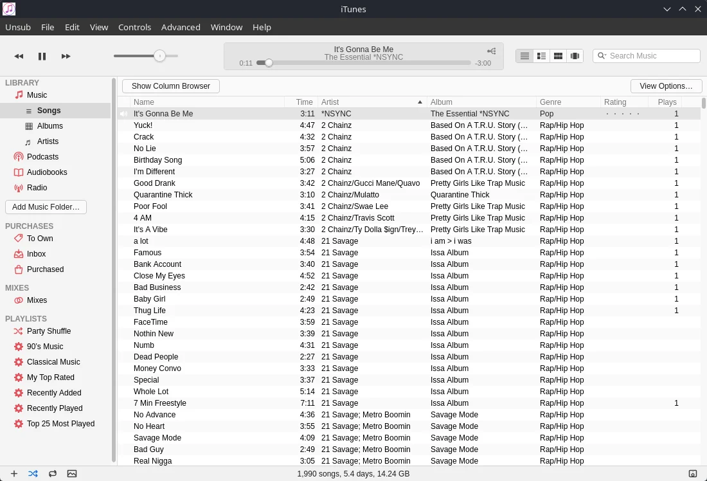
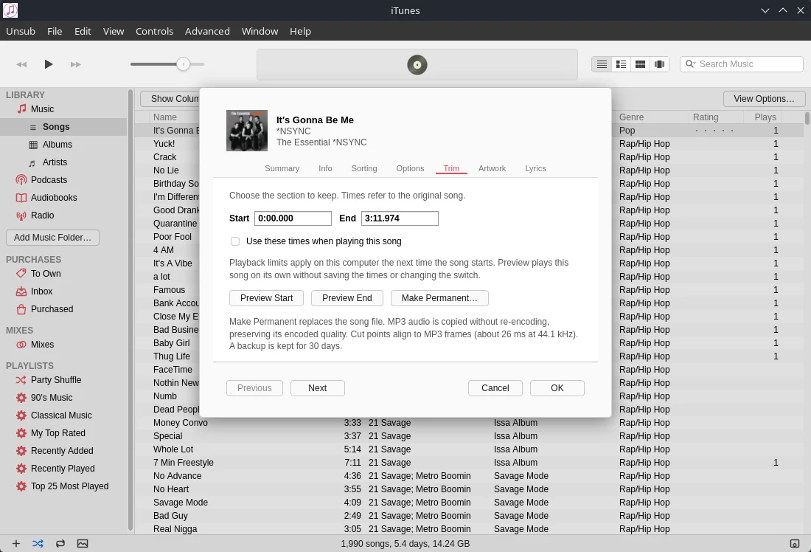

# Linux iTunes-style customization

This branch adds an optional iTunes 12 inspired appearance, KDE window controls, media integration, and song trimming.

## Music library

The light appearance includes a compact song table, sidebar navigation, a round volume slider with scroll adjustment, and volume boost up to 130%. Shuffle is remembered between launches. Returning to Songs preserves the previous scroll position.

Click the current song’s title in the top display to select it and scroll it into view. Hidden-song filters are cleared as needed, and playback continues at the same position. The title is also keyboard accessible with Tab, then Enter or Space.

## MP3 trimming

Open a song’s **Get Info → Trim** tab to specify the beginning and end of the section to keep. **Preview Start** and **Preview End** audition the boundaries. The playback checkbox applies the limits locally without changing the source file.

**Make Permanent…** replaces the original file. MP3 audio is copied at frame boundaries without re-encoding; cut points are approximately 26 ms apart at 44.1 kHz. A backup is retained for 30 days. Permanently changed files can be copied to another player without needing its support for trim settings.

## Recovery after audio-device loss

If a file’s audio output disappears, playback retains the current song, position, and queue in a paused state. Play reopens the output and resumes from that position. Returning to the window refreshes the transport state from the backend.

Validation: a simulated audio-device loss/resume regression test passes, and the Linux release build succeeds. Physical suspend/resume still needs verification on the affected machine.
